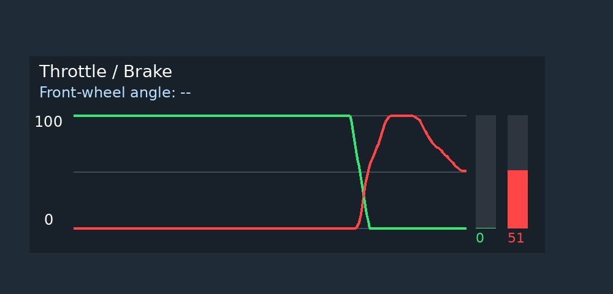
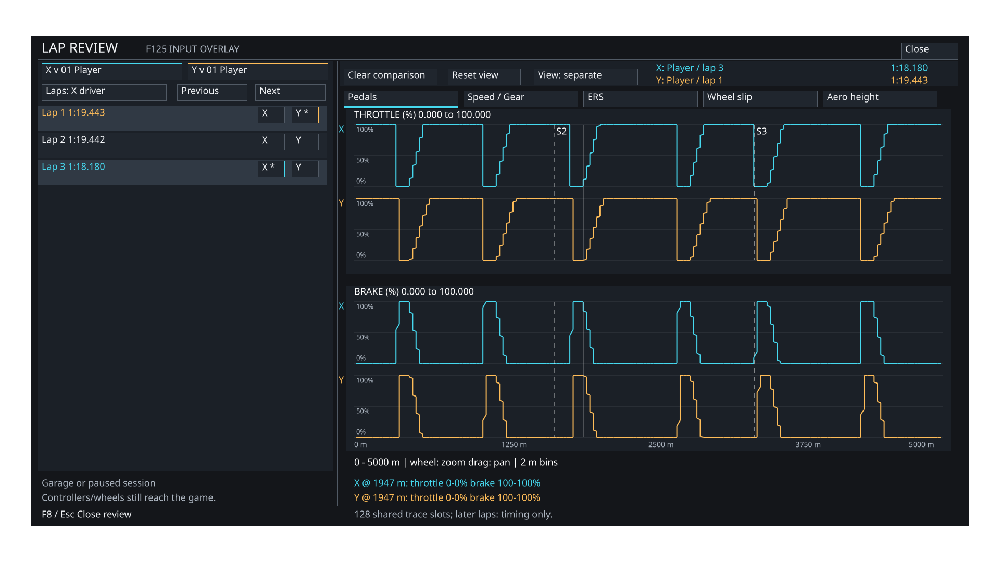

# F1 25 Input Overlay

See how you apply throttle and brake while driving in F1 25, then compare recorded laps back in the garage. This addon runs through Swofty Launcher on Windows x64.

- Live green throttle and red brake traces, percentage labels and optional input bars.
- Five seconds of history by default, adjustable from 2 to 15 seconds.
- Adjustable panel size, position and background opacity.
- Session lap review with two-lap comparisons, distance-based graphs, zoom and pan.

The display uses game-reported inputs, not pedal force or raw hardware readings. It does not provide driving assistance or change car behaviour.

## Preview

The live HUD image shows the earlier layout. The F8 preview is rendered from the current panel using synthetic lap data; in-game appearance may vary.

### Live inputs

### F8 lap comparison

## Install and start driving

You need F1 25 on Windows x64 and Swofty Launcher 1.3.7 or newer, with its experimental overlay feature permitted. Lap review also requires a Swofty core with overlay input v3.

1. Check [Releases](https://github.com/L0G4NN/F125-Input-Overlay/releases) for a compiled `.swoftyaddon` package. GitHub's **Source code** ZIP is not an installable addon. If no compiled package is available, see the [developer build instructions](docs/DEVELOPMENT.md).
2. Close F1 25, then import the `.swoftyaddon` using Swofty's **Addons** page or drag it onto the launcher. Leave the file archived.
3. Enable **F1 25 Input Overlay** in your offline profile and launch the game through Swofty.
4. In F1 25's Telemetry Settings, use:

   | Setting | Value |
   | --- | --- |
   | UDP Telemetry | On |
   | UDP Broadcast Mode | Off |
   | UDP IP Address | `127.0.0.1` |
   | UDP Port | `20777` |
   | UDP Format | `2025` |
   | UDP Send Rate | 60 Hz (30 Hz is also accepted) |

5. Start an offline practice session and leave the garage. The live panel is hidden in the garage and menus by default. New input appears at the right of the graph.

Another telemetry app cannot listen on port 20777 at the same time. The addon uses a fixed port and does not forward packets.

Before telemetry arrives, a compact **Waiting for UDP** label appears without a trace box. Paused and known garage contexts remain hidden. The full graph appears once live inputs and on-track metadata are available.

## Adjust the display

Open **ADDON SETTINGS → F1 25 Input Overlay** in Swofty to change history, input bars, size, opacity and position.

Choose a corner, then move inward with **Horizontal position** and **Vertical position**: 0% stays at the selected corner, 50% centres that axis, and 100% reaches the opposite edge. The panel stays inside the screen. Mouse dragging is not available.

## Compare driver laps

Leave **Record session laps in memory** on while driving. Pause during the session (or return to the garage unpaused), press **F8** while the game window is active.

Choose drivers independently with the **X v** and **Y v** buttons. Use **Laps: X driver / Y driver** to choose whose list to browse, then select **X** and **Y** beside completed laps. X is cyan and Y is amber, with separate comparison graphs for throttle and brake. Scroll over a graph to zoom, drag to pan, and use **Reset view** to fit the lap. Press **Escape**, **Close**, or your review key to return to the game. The review key can be changed to F6–F12.

**F8 retains up to 70 detailed completed laps per driver**, plus the active lap, for up to 22 cars. Later laps show **NO TRACE** and retain timing. Very long layouts may lower the per-driver quota to stay within the 256 MiB recorder budget. F8 displays the session quota. Slip and aero data remain player-only; restricted opponent ERS is shown as unavailable. See [multi-driver review](docs/MULTI_DRIVER_REVIEW.md) for limits and validation.

Recorded laps stay in memory only. Exiting the game or a session reset clears them. A detected rewind preserves earlier laps and the affected lap’s prefix, discarding the abandoned suffix and later laps. There is no save or export feature. See the [full user guide](docs/INSTALL.md#review-and-compare-laps) for controls and recording limits.

## Need help?

- **No panel while driving:** check the addon is enabled, the overlay feature is permitted, and UDP matches the table above. Missing or stale telemetry hides the panel by default.
- **Waiting for UDP:** check format **2025**, address `127.0.0.1` and port `20777`. Close other apps listening on that port and restart the game.
- **F8 does nothing:** pause from an active session or return to the garage, keep the game window active. Check recording and the master toggle are on. Older cores can support the live HUD without lap review.

See [installation, settings and troubleshooting](docs/INSTALL.md), or [report a problem](https://github.com/L0G4NN/F125-Input-Overlay/issues).

## More information

- [User guide](docs/INSTALL.md) · [Changelog](CHANGELOG.md)
- [Development and building](docs/DEVELOPMENT.md) · [Contributing](CONTRIBUTING.md)
- [Requirements](docs/REQUIREMENTS.md) · [Architecture](docs/ARCHITECTURE.md) · [Test plan](docs/TEST_PLAN.md)
- [Sources and compatibility](docs/SOURCES.md) · [Runtime validation notes](docs/CONFORMANCE.md)

The live HUD is hidden in garage/paused/unknown contexts by default to avoid covering game-menu text. See [issue #8 validation](docs/SETUP_NAMING.md) for the mitigation, troubleshooting override and remaining in-game check.

Review closes when resuming on track. Held controls do not block paused review. Paused access cannot distinguish ordinary pause from replay/flashback; close F8 before using flashback controls. The reported stuck-throttle behaviour still requires in-game verification; this addon does not write vehicle inputs.

F8 also includes Speed/Gear, ERS, per-wheel Slip and Aero Height pages, with dashed S2/S3 boundaries. The live HUD shows the reported front-wheel steering angle in degrees. See [extended telemetry](docs/EXTENDED_TELEMETRY.md) for units, 16 m resolution and validation limits.

## F8 pause access update

F8 now opens whenever Swofty reports a pause, without a fresh-UDP or pre-pause latch requirement. Held keys, controller buttons, triggers, stick drift and other navigation no longer block opening or automatically close review. F8, Escape and Close still close it; resuming on track, window/focus loss, reset and disable still release focus. Unpaused access remains garage-only. Close review manually before setup typing or flashback controls. This supersedes earlier freshness/held-control restrictions above; in-game behaviour remains to be verified.
